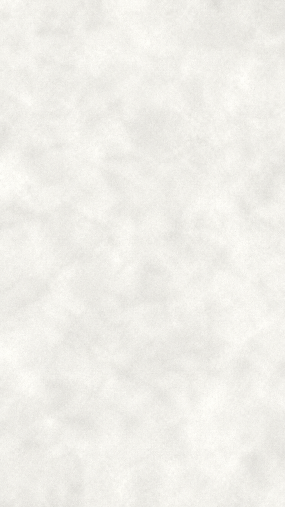

# Thư viện bìa và mẫu mở đầu

[Về chỉ mục tài liệu](../README.md) · [Quy chuẩn hình ảnh](../02_Quy_chuan/HINH_ANH.md)

Lưu bìa/thumbnail và mẫu mở đầu tại đây để dễ tìm theo tập. Tên đề nghị: `tap-02-ten-chu-de-bia-v01.png`; sau khi chốt, ghi rõ tệp được duyệt trong README của tập và tại đây.

## Nền mới đã chốt

**[Mở nền giấy đã chốt](da_chot/nen-giay-da-chot.png)** — nền của bản Trương Phi ngay trước v4, dùng tiếp cho Tập 2.

Bản này giữ nguyên ảnh gốc để dễ lấy dùng. Khi dựng áp dụng `brightness(0.995)` theo `Quy_trinh_video/visual-profile.json`. Bản tương ứng dùng chung cho công cụ vẫn ở `Quy_trinh_video/assets/nen-giay-chuan.png`; nếu thay nền chuẩn, cập nhật cả hai vị trí. Các mẫu cũ bên dưới chỉ để đối chiếu.

## Mẫu cũ để tham khảo

| Tệp | Nội dung | Trạng thái |
|---|---|---|
| [Mẫu mở đầu ngang](luu_tru_mau_cu/mau_mo_dau.png) | Bản chất của vàng, bố cục ngang | Mẫu cũ |
| [Mẫu dọc Shorts](luu_tru_mau_cu/mau_short.png) | Bản chất của vàng, bố cục dọc | Mẫu cũ |

Hai ảnh trên là thử nghiệm cũ, có tạo hình và nền trước quy chuẩn hiện hành; **không phải bìa đã chốt cho Tập 1 hoặc Tập 2**. Hiện chưa có bìa riêng được duyệt cho hai tập này.

Logo và các tài nguyên dùng để dựng video vẫn nằm trong `Quy_trinh_video/assets/` tính từ gốc dự án. Các MP4 và ảnh QA vẫn đi cùng hồ sơ từng tập.
