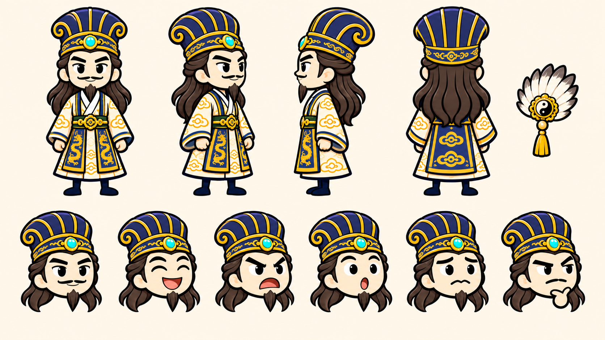
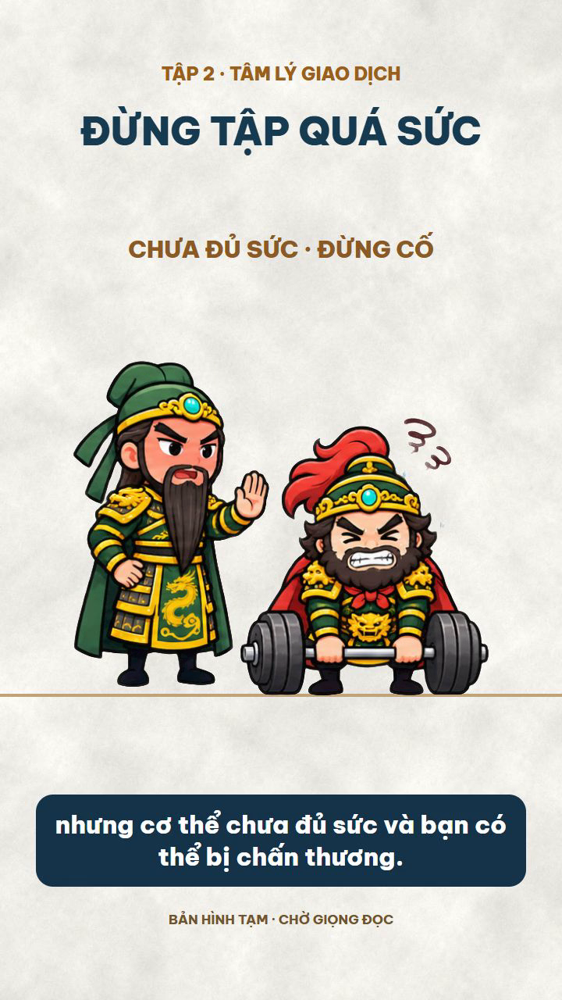
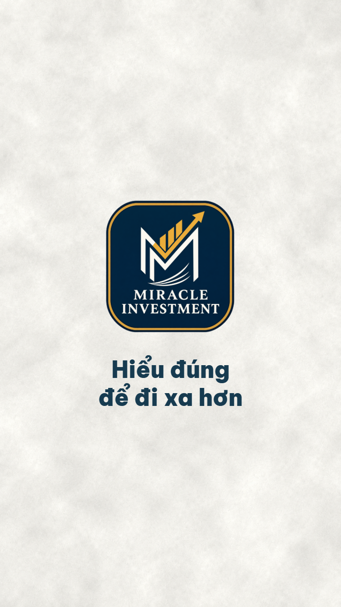

# Quy trình sản xuất video tài chính ngắn

**Tài liệu dành cho Ban giám đốc**  
Cập nhật: 10/11/2026 · Định dạng áp dụng: YouTube Shorts và TikTok

## 1. Mục đích và sản phẩm

Quy trình này chuyển một kịch bản tài chính thành video dọc ngắn, sử dụng bộ nhân vật minh họa thống nhất của tổ chức. Video kết hợp lời dẫn, phụ đề tiếng Việt, các tình huống và tương tác giữa nhân vật, sau đó kết thúc bằng logo **MIRACLE INVESTMENT** và slogan **“Hiểu đúng để đi xa hơn”**.

Đầu ra thông thường gồm:

1. Video MP4 có hình, lời đọc và phụ đề.
2. File âm thanh gốc và file phụ đề SRT đã căn theo giọng đọc.
3. Hồ sơ tập: kịch bản, phân cảnh, hình minh họa, thời gian dựng và tài liệu kiểm tra để có thể sửa hoặc làm tập sau.

Thời lượng được xác định theo kịch bản và nhịp đọc thực tế. Các video đã thử có thời lượng khoảng một phút; không cắt lời hoặc tăng tốc máy móc để ép đủ một con số.

## 2. Toàn cảnh quy trình

```text
Kịch bản → Chốt nội dung và nhân vật → Chia cảnh → Tạo hình minh họa
          → Dựng bản hình → Nhận hoặc tạo giọng đọc
          → Đồng bộ giọng, cảnh và phụ đề → Thêm logo, slogan
          → Kiểm tra → Xuất và lưu trữ thành phẩm
```

Việc dựng là quá trình có thể điều chỉnh: nếu người duyệt phát hiện lỗi hình, nội dung hoặc nhịp đọc, nhóm quay lại bước tương ứng, sửa nguồn và xuất lại bản mới.

## 3. Bước 1 — Nhận yêu cầu và kịch bản

**Thực hiện**

- Tiếp nhận chủ đề, kịch bản gốc, thông điệp chính, đối tượng xem và thời lượng mong muốn.
- Xác định người dẫn chuyện, nhân vật minh họa, nền tảng đăng và nguồn giọng đọc: người dùng cung cấp hay yêu cầu tạo bằng ElevenLabs.
- Lưu nguyên văn kịch bản gốc. Nếu cần chuyển đối thoại thành một lời dẫn, biên tập lại để dễ nghe nhưng giữ đúng ý, dữ kiện và thông điệp.
- Với số liệu, tin tức hoặc nhận định tài chính mới, kiểm tra nguồn trước khi đưa vào. Biểu đồ không dùng dữ liệu thật phải được hiểu là hình minh họa.

**Kết quả:** Bản kịch bản gốc, lời dẫn thống nhất và bản mô tả yêu cầu của tập. Lời dẫn đã chốt là căn cứ cho giọng đọc, phụ đề và hình ảnh.

## 4. Bước 2 — Chọn nhân vật và thống nhất cách thể hiện

Nhóm chọn nhân vật theo vai trò trong kịch bản và dùng đúng ảnh tham chiếu. Năm nhân vật hiện có:

| Nhân vật | Đặc điểm nhận diện |
|---|---|
| Gia Cát Lượng | Mũ xanh lam–vàng, áo trắng–lam, quạt lông; có thể đảm nhiệm vai quân sư hoặc người dẫn chuyện. |
| Trương Phi | Lông mũ đỏ, râu rậm, giáp xanh–vàng, áo choàng đỏ. |
| Quan Vũ / Quan Vân Trường | Mặt đỏ, khăn xanh, râu dài, giáp xanh–vàng. |
| Lưu Bị | Mũ xanh–vàng, áo kem–vàng, áo choàng xanh. |
| Triệu Tử Long | Giáp bạc, lông mũ trắng, khăn lam, gương mặt trẻ không râu. |



*Minh họa: ảnh tham chiếu Gia Cát Lượng. Các góc nhìn và biểu cảm giúp giữ nhận diện khi tạo các tư thế mới.*

Hồ sơ vai trò, tính cách và cách tương tác đã được chuẩn bị cho từng nhân vật. **Các mô tả tính cách hiện là đề xuất, chờ người dùng duyệt**; kịch bản cụ thể và yêu cầu mới được ưu tiên. Giọng đọc chuẩn của cả series cũng chưa chốt.

**Kết quả:** Danh sách nhân vật của tập, ảnh chuẩn và hướng thể hiện cho từng người.

## 5. Bước 3 — Chia cảnh và lập thời gian tạm

Mỗi ý trong lời dẫn được chuyển thành một hoặc nhiều cảnh. Với mỗi cảnh, nhóm xác định:

- Câu dẫn tương ứng, thời gian dự kiến và thông điệp cần người xem hiểu.
- Nhân vật xuất hiện, hướng nhìn, biểu cảm và hành động.
- Đạo cụ, nội dung chữ ngắn trên màn hình và thời điểm nhân vật tương tác.
- Diễn tiến hợp lý: chuẩn bị → thao tác → phản ứng → kết thúc.

Nhịp dựng quy định mỗi cảnh nội dung không quá **10 giây**; sau tối đa 10 giây phải có sự thay đổi hình ảnh rõ ràng như hành động, tương tác, góc nhìn hoặc bố cục phù hợp với lời dẫn. Chỉ thay phụ đề hay phóng to một ảnh cũ không được tính là cảnh mới. Nhóm kiểm tra lại giới hạn này sau khi đồng bộ giọng đọc; đoạn logo và slogan 3 giây cuối giữ theo quy chuẩn riêng.

Mỗi phân cảnh ưu tiên có hình và hành động riêng; hạn chế tối đa việc lặp lại nguyên một cảnh. Nhóm chuẩn bị đủ tư thế, đạo cụ, góc nhìn và tương tác theo từng ý, rồi đối chiếu danh sách asset và bản video để phát hiện hình trùng hoặc quá giống. Trường hợp cần lặp để phục vụ câu chuyện được ghi rõ vị trí và lý do khi bàn giao. Đổi chữ, lật, cắt hay phóng ảnh cũ không được xem là tạo một cảnh khác biệt.

Trong mỗi cảnh, nhóm còn chuẩn bị nhiều hình cùng bố cục và nhân vật để thể hiện diễn biến hành động, thông thường gồm trạng thái đầu, giữa và cuối; bổ sung hình chuyển tiếp khi cần. Cách này giúp nhân vật phản ứng và tương tác trong cảnh. Nhóm xem đoạn dựng ở tốc độ thực để kiểm tra tay, đạo cụ, điểm chạm đất và độ mượt; hình tương tự trong cùng một chuỗi hành động không bị xem là lặp lại một phân cảnh khác.

Mỗi cảnh có thể thêm icon minh họa khi phù hợp, như đồng hồ, bảng kiểm hay lá chắn. Icon được chọn theo ý lời dẫn và phong cách chibi, xuất hiện đúng nhịp, không che nhân vật hoặc phụ đề; không bắt buộc dùng ở mọi cảnh. Nhóm kiểm tra vị trí, ý nghĩa và thời gian hiển thị trong bản dựng.

Cách dựng đã được mô tả thành [quy trình chuyển động nhân vật](../01_Quy_trinh/CHUYEN_DONG_NHAN_VAT.md), không cần xem lại video mẫu để hiểu các bước. Nhóm chuẩn bị tư thế chính, bổ sung các khung nối, dựng một đoạn thử của tập đang làm và kiểm tra trước khi mở rộng; thời lượng hình bám lời dẫn và được căn lại khi có giọng đọc.

Ví dụ ở Tập 2, ý “cố nâng tạ quá sức” được thể hiện bằng Quan Vũ nâng tạ, Trương Phi thử theo, sau đó Quan Vũ ra hiệu dừng. Cảnh cuối chuyển sang một quy tắc nhỏ và luyện tập từng bước.

**Kết quả:** Bảng phân cảnh và mốc thời gian tạm, kèm SRT tham khảo. Các mốc được căn lại khi có giọng đọc thực tế.

## 6. Bước 4 — Tạo hình minh họa và tư thế

Nhóm dùng ảnh chuẩn làm tham chiếu để tạo từng nhóm tư thế phù hợp kịch bản: suy nghĩ, giải thích, chỉ biểu đồ, cầm đạo cụ, phản ứng với người khác hoặc cùng thực hiện một việc.

Mỗi tư thế được kiểm tra trước khi đưa vào video:

- Nhân vật đúng diện mạo, trang phục và màu sắc đã thống nhất.
- Mỗi nhân vật có đúng hai tay; tay nối với cơ thể và cầm đạo cụ hợp lý.
- Ảnh tách nền sạch, không còn ô nền trắng hay bóng oval xanh.
- Mũ, lông mũ, chân và đạo cụ không bị cắt; vị trí chân phù hợp với mặt sàn.



*Minh họa: Quan Vũ nhắc dừng khi Trương Phi cố nâng tạ quá sức.*

**Mức chuyển động hiện tại:** Video dùng chuỗi tư thế vẽ sẵn, thay đổi biểu cảm, đạo cụ và hiệu ứng theo cảnh. Đây chưa phải hoạt hình khớp xương liên tục hoặc khẩu hình tự động. Dự án tiếp tục dùng Remotion; HyperFrames và thử nghiệm tay ghép rời hiện chưa áp dụng trong quy trình chính.

**Kết quả:** Các ảnh/tư thế đã kiểm tra và danh mục tài nguyên của tập.

## 7. Bước 5 — Dựng bản hình

Nhóm đưa các cảnh và tư thế vào Remotion, sắp xếp theo lời dẫn tạm. Các nhân vật cần hướng nhìn, phản ứng và tương tác hợp lý với nhau hoặc với đạo cụ; hình ảnh thay đổi theo từng ý để người xem theo dõi câu chuyện.

Quy chuẩn hình ảnh hiện hành:

| Thành phần | Quy chuẩn |
|---|---|
| Khung hình | Dọc 9:16, thông thường 720 × 1280 pixel, 30 hình/giây. |
| Nền | Nền giấy sáng có vân nhẹ, theo bản Trương Phi được chốt trước bản v4. |
| Font | Be Vietnam Pro, hỗ trợ đầy đủ dấu tiếng Việt. |
| Tiêu đề | Xanh đậm, nhất quán giữa các cảnh. |
| Chữ nhấn | Nâu vàng. |
| Phụ đề | Chữ trắng trên ô xanh đậm, không đổi màu theo cảnh. |

Có thể xuất 1080 × 1920 khi có yêu cầu và sau khi kiểm tra lại bố cục theo tỷ lệ mới.

**Kết quả:** Bản hình xem thử, thường chưa có giọng nếu bản thu chưa sẵn sàng.

## 8. Bước 6 — Chuẩn bị giọng đọc

Có hai cách thực hiện tùy yêu cầu của từng video:

**Cách A — Người dùng cung cấp bản thu.** Nhóm gửi lời dẫn/SRT tham khảo, nhận file WAV hoặc MP3, giữ nguyên bản gốc và kiểm tra thời lượng, chất lượng âm thanh.

**Cách B — Tạo giọng bằng ElevenLabs.** Chọn giọng và model phù hợp, dùng lời dẫn đã chốt để tạo âm thanh; lưu tên giọng, model và tệp audio của tập. API key được lưu trong môi trường máy, không đưa vào tài liệu hoặc tin nhắn.

Tình trạng thực tế của dự án: ElevenLabs đã kết nối. Tập 2 có bản thử giọng **Anh – Warm, Calm and Deep**, tạo bằng giao diện ElevenLabs vì tài khoản miễn phí trả lỗi khi dùng giọng thư viện qua API. Giọng này **chưa được chốt làm giọng chuẩn**. Sau khi nâng cấp, nhóm sẽ thử và để người dùng chốt giọng cho series. Chi phí, hạn mức và khả năng sử dụng giọng cần kiểm tra theo gói tại thời điểm tạo.

**Kết quả:** File âm thanh gốc và thông tin giọng dùng cho tập. Không tự tạo thêm giọng đọc cho slogan nếu chưa có yêu cầu.

## 9. Bước 7 — Đồng bộ giọng, phụ đề và hành động

- Xác định thời điểm bắt đầu và kết thúc của từng câu trong bản đọc.
- Căn lại phụ đề theo lời thực tế; các mốc trong SRT tạm không còn được xem là mốc cuối.
- Điều chỉnh thời gian xuất hiện của cảnh, tư thế, biểu đồ và đạo cụ sao cho khớp nội dung đang đọc.
- Kiểm tra chữ hiển thị đủ thời gian, không che nhân vật hoặc bị cắt; giữ nguyên âm cuối và khoảng nghỉ tự nhiên.

Nếu giọng tạo bằng ElevenLabs có dữ liệu thời gian đi kèm, có thể dùng để căn. Với audio không có mốc, dự án sử dụng công cụ nhận dạng tiếng Việt cục bộ để lấy mốc ban đầu rồi đối chiếu lại. Kết quả nhận dạng là hỗ trợ kiểm tra, không thay thế việc nghe rà cách phát âm.

**Kết quả:** Timeline mới, phụ đề SRT đồng bộ và video có nhịp theo bản đọc thực tế.

## 10. Bước 8 — Kết video bằng logo và slogan

Sau lời kết, giữ cảnh nhân vật cuối khoảng **2 giây** tùy nhịp bản thu, rồi chuyển mờ nhẹ sang thẻ kết. Thẻ kết mặc định hiển thị trong **3 giây**, gồm logo cách điệu phía trên và slogan phía dưới, trên nền giấy chuẩn.



*Minh họa: bố cục logo và slogan đã được áp dụng thử ở cuối Tập 2.*

Không dồn nhanh cảnh cuối để đến slogan. Tên tập, phụ đề và nhãn bản tạm được bỏ khỏi thẻ kết; slogan chỉ hiển thị bằng chữ nếu không có yêu cầu đọc.

## 11. Bước 9 — Kiểm tra trước khi bàn giao

Nhóm kiểm tra trên các khung hình mẫu và trên chính video đã xuất:

| Nội dung | Cần kiểm tra |
|---|---|
| Nội dung | Đúng kịch bản, số liệu và thông điệp; không thêm khẳng định tài chính chưa được kiểm tra. |
| Nhân vật | Đúng ảnh chuẩn, hai tay, tương tác hợp lý, chân chạm sàn, mũ/đạo cụ đầy đủ. |
| Hình ảnh | Nền sạch, không viền trắng hoặc bóng xanh; bố cục và màu sắc nhất quán. |
| Chữ | Dấu tiếng Việt rõ, nội dung đúng, không bị che hoặc tràn khung. |
| Giọng và phụ đề | Có âm thanh, không im lặng hoặc mất đầu/cuối; phụ đề và hành động khớp lời. Nghe rà phát âm nếu có thể. |
| Đoạn kết | Nhịp kết tự nhiên, logo đúng, slogan đúng câu, hiển thị đủ thời gian. |

Kết quả tự động chỉ hỗ trợ phát hiện lỗi. Nếu chưa thể nghe trực tiếp bản đọc, nhóm phải ghi rõ để người duyệt nghe kiểm tra, thay vì xác nhận đã nghe.

## 12. Bước 10 — Xuất, bàn giao và lưu trữ

Video được xuất dạng **MP4 H.264**, âm thanh **AAC** khi có giọng. Nhóm bàn giao đường dẫn video, audio gốc và SRT đồng bộ; nêu thời lượng, trạng thái giọng đọc và điểm còn cần người duyệt kiểm tra.

Mỗi tập có hồ sơ riêng trong thư mục `Videos/`: kịch bản và audio ở `input/`, timeline/SRT ở `src/`, ảnh kiểm tra ở `qa/`, MP4 ở `out/`. Ảnh và code dùng khi dựng được lưu cùng môi trường Remotion, có ghi đường dẫn trong hồ sơ tập. Các bản cũ được ghi rõ để đối chiếu; bản hiện hành được xác định trong README và danh mục video.

## 13. Ví dụ đã thực hiện: Tập 2

**Chủ đề:** “Kỷ luật là một cơ bắp”.  
**Người dẫn:** Gia Cát Lượng.  
**Nhân vật minh họa:** Gia Cát Lượng, Trương Phi và Quan Vũ.

- Bản hình ban đầu dài 56,7 giây; sau khi thêm logo và slogan, bản chưa có giọng dài 59,7 giây.
- Đã tạo bản thử giọng ElevenLabs và đồng bộ cảnh/phụ đề; bản có giọng dài khoảng 49,2 giây.
- Hệ thống đối chiếu lời và bản nhận dạng đạt khoảng 97,6%; **chưa xác minh phát âm bằng nghe tai**, vì vậy bản giọng vẫn cần người duyệt nghe trước khi chốt.
- Giọng của Tập 2 là **bản thử**, không đại diện cho giọng chuẩn của toàn series.

[Xem video Tập 2 có giọng thử](../../Videos/tap-02-ky-luat-la-mot-co-bap/out/tap-02-giong-elevenlabs.mp4) · [Nghe bản giọng đọc](../../Videos/tap-02-ky-luat-la-mot-co-bap/input/elevenlabs-anh-v4.mp3) · [Xem SRT đồng bộ](../../Videos/tap-02-ky-luat-la-mot-co-bap/src/voice.aligned.srt)

## 14. Tài liệu và thư viện liên quan

- [Quy trình sản xuất chi tiết cho nhóm thực hiện](../01_Quy_trinh/SAN_XUAT_VIDEO.md).
- [Quy chuẩn hình ảnh và màu chữ](../02_Quy_chuan/HINH_ANH.md).
- [Thư viện năm ảnh nhân vật](../05_Nhan_vat/README.md) và [hồ sơ nhân vật](../08_Dac_ta_nhan_vat/README.md).
- [Thư viện giọng đọc](../07_Giong_doc/README.md), [bìa và nền](../06_Bia/README.md), [danh mục các video](../../Videos/README.md).

Các hình minh họa và liên kết trong tệp này sử dụng đường dẫn tương đối trong dự án. Khi gửi riêng file Markdown ra ngoài, cần gửi kèm các tệp hình/video liên quan hoặc xuất tài liệu sang định dạng phù hợp để người nhận xem được hình.
